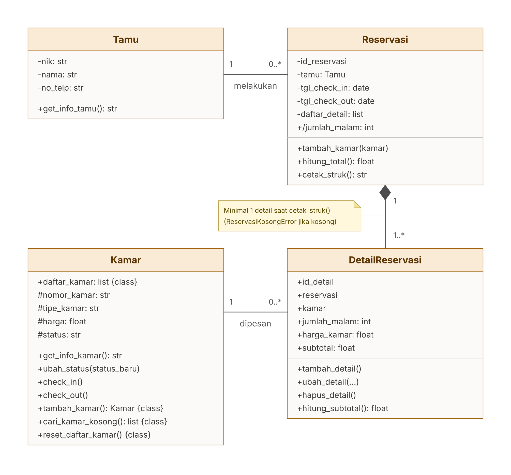

# Aplikasi Manajemen Reservasi Hotel — MVC + Streamlit + SQLite

Aplikasi berbasis **Object-Oriented Programming (OOP)**, arsitektur **MVC (Model-View-Controller)**, dan **Streamlit** untuk mengelola data kamar, tamu, dan reservasi hotel menggunakan **SQLite** sebagai database.

---

## Implementasi Sesuai Class Diagram



---

## Rincian Entitas

### 1. Tamu
- **Atribut**: nik (primary key), nama, no_telp
- **Method**: `get_info_tamu()` — mengembalikan informasi lengkap tamu
- **Relasi**: Ber-**Association** ke Reservasi (satu tamu dapat memiliki banyak reservasi)

### 2. Reservasi
- **Atribut**:
  - `id_reservasi` (primary key)
  - `tamu` (foreign key, objek `Tamu`)
  - `tgl_check_in` (tanggal masuk, bertipe `date`)
  - `tgl_check_out` (tanggal keluar, bertipe `date`)
  - `daftar_detail` (list detail reservasi)
  - Semua atribut bersifat private dan diakses lewat `@property`. Selain itu ada property turunan `jumlah_malam`, yaitu selisih hari antara `tgl_check_out` dan `tgl_check_in`.
- **Method**:
  - `tambah_kamar(kamar)` — menambahkan detail kamar ke reservasi. Jumlah malam diambil otomatis dari tanggal check-in dan check-out. Kamar harus berstatus tersedia, dan statusnya berubah menjadi tidak tersedia setelah ditambahkan.
  - `hitung_total()` — menghitung total harga reservasi dengan menjumlahkan subtotal semua detail.
  - `cetak_struk()` — mencetak struk reservasi (ID, data tamu, tanggal check-in dan check-out, lama menginap, rincian kamar, dan total).
- **Validasi (Custom Exception)**:
  - `TamuTidakValidError` — jika tamu bukan objek `Tamu`.
  - `TanggalTidakValidError` — jika tanggal bukan objek `date`, atau check-out tidak setelah check-in.
  - `KamarTidakTersediaError` — jika kamar yang ditambahkan tidak tersedia.
  - `ReservasiKosongError` — jika struk dicetak sebelum ada kamar yang dipesan.
  - Semuanya turunan dari `ReservasiError`.
- **Relasi**:
  - Ber-**Association** ke Tamu (reservasi menyimpan referensi ke tamu pemiliknya).
  - Ber-**Composition** ke DetailReservasi (reservasi "memiliki" detail reservasi, dan objek detail dibuat di dalam `tambah_kamar()`. Jika reservasi dihapus, detailnya juga ikut hapus).

### 3. DetailReservasi
- **Atribut**: kamar (foreign key), jumlah_malam
- **Method**: `get_subtotal()` — menghitung subtotal berdasarkan harga kamar dan jumlah malam
- **Relasi**: Ber-**Aggregation** ke Kamar (detail reservasi "menggunakan" kamar, tetapi kamar dapat exist tanpa detail reservasi tertentu)

### 4. Kamar
- **Atribut**: nomor_kamar (primary key), tipe_kamar, harga, status (tersedia/tidak tersedia)
- **Method**: 
  - `get_info_kamar()` — mengembalikan info kamar beserta status
  - `ubah_status()` — mengubah status kamar (tersedia <-> dijual)
- **Relasi**: Menjadi target dari Aggregation oleh DetailReservasi

---

## Struktur Proyek MVC

```text
reservasi_hotel_mvc_database/
├── app.py
├── pages/
│   ├── 1_Kamar.py
│   ├── 2_Tamu.py
│   └── 3_Reservasi.py
├── models/
│   ├── __init__.py
│   ├── kamar.py
│   ├── tamu.py
│   ├── reservasi.py
│   ├── detail_reservasi.py
│   └── user.py
├── views/
│   ├── auth_view.py
│   ├── kamar_view.py
│   ├── tamu_view.py
│   └── reservasi_view.py
├── controllers/
│   ├── auth_controller.py
│   ├── kamar_controller.py
│   ├── tamu_controller.py
│   └── reservasi_controller.py
├── database/
│   ├── db.py
│   └── reservasi_hotel.db
├── tests/
│   ├── __init__.py
│   ├── test_kamar.py
│   ├── test_tamu.py
│   └── test_reservasi.py
├── requirements.txt
├── .env.example
└── README.md
```
