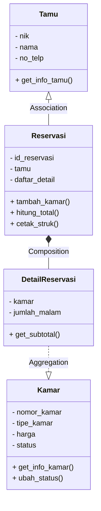

# Aplikasi Manajemen Reservasi Hotel — MVC + Streamlit + SQLite

Aplikasi berbasis **Object-Oriented Programming (OOP)**, arsitektur **MVC (Model-View-Controller)**, dan **Streamlit** untuk mengelola data kamar, tamu, dan reservasi hotel dengan **SQLite** sebagai database.

---

## Class Diagram



---

## Rincian Entitas

### 1. Tamu
- **Atribut**: `nik` (primary key), `nama`, `no_telp`
- **Method**: `get_info_tamu()` — mengembalikan informasi lengkap tamu
- **Relasi**: **Association** ke `Reservasi` (1 tamu dapat memiliki 0..* reservasi)

### 2. Reservasi
- **Atribut**: id_reservasi (primary key), tamu (foreign key), daftar_detail (list detail reservasi)
- **Method**: 
  - `tambah_kamar()` — menambahkan detail kamar ke reservasi
  - `hitung_total()` — menghitung total harga reservasi
  - `cetak_struk()` — mencetak struk reservasi
- **Relasi**: Ber-**Composition** ke DetailReservasi (reservasi "memiliki" detail reservasi, jika dihapus reservasi, detailnya juga ikut hapus)

### 3. DetailReservasi
- **Atribut**: `id_detail`, `reservasi`, `kamar`, `jumlah_malam`, `harga_kamar`, `subtotal`
- **Method**:
  - `tambah_detail()` — validasi data lalu menghitung subtotal
  - `ubah_detail()` — mengubah detail (data lama dikembalikan jika data baru tidak valid)
  - `hapus_detail()` — mengosongkan detail
  - `hitung_subtotal()` — `harga_kamar × jumlah_malam`
- **Relasi**: **Association** ke `Kamar` (setiap detail merujuk tepat 1 kamar)

### 4. Kamar
- **Atribut**: `nomor_kamar` (primary key), `tipe_kamar`, `harga`, `status` (`Tersedia` / `Terisi`), `daftar_kamar` (koleksi level class)
- **Method**:
  - `get_info_kamar()` — info lengkap kamar beserta status
  - `ubah_status(status_baru)` — mengubah status dengan validasi
  - `check_in()` / `check_out()` — memanggil `ubah_status()`
  - `tambah_kamar()`, `cari_kamar_kosong()`, `reset_daftar_kamar()` — class method
- **Relasi**: Dirujuk oleh `DetailReservasi` (1 kamar dapat muncul di 0..* detail)

---

## Custom Exception

| Kelas | Exception | Kondisi |
|---|---|---|
| Kamar | `KamarSudahAdaError` | Nomor kamar sudah terdaftar |
| Kamar | `KamarPenuhError` | Check-in pada kamar yang sudah terisi |
| Kamar | `KamarKosongError` | Check-out pada kamar yang sudah tersedia |
| DetailReservasi | `DataDetailTidakLengkapError` | Field detail belum diisi |
| DetailReservasi | `JumlahMalamTidakValidError` | Jumlah malam bukan bilangan bulat > 0 |
| DetailReservasi | `HargaKamarTidakValidError` | Harga bukan angka atau < 0 |
| DetailReservasi | `DetailSudahAdaError` / `DetailTidakDitemukanError` | Tambah ganda / ubah-hapus sebelum ada |
| Reservasi | `TamuTidakValidError` | Tamu bukan objek `Tamu` |
| Reservasi | `TanggalTidakValidError` | Tanggal tidak valid atau check-out ≤ check-in |
| Reservasi | `KamarTidakTersediaError` | Kamar yang dipilih tidak tersedia |
| Reservasi | `ReservasiKosongError` | Cetak struk tanpa kamar |

---

## Struktur Proyek MVC

```text
reservasi_hotel_mvc_database/
├── app.py
├── pages/
│   ├── 1_Kamar.py
│   ├── 2_Tamu.py
│   └── 3_Reservasi.py
├── models/
│   ├── __init__.py
│   ├── kamar.py
│   ├── tamu.py
│   ├── reservasi.py
│   ├── detail_reservasi.py
│   └── user.py
├── views/
│   ├── auth_view.py
│   ├── kamar_view.py
│   ├── tamu_view.py
│   └── reservasi_view.py
├── controllers/
│   ├── auth_controller.py
│   ├── kamar_controller.py
│   ├── tamu_controller.py
│   └── reservasi_controller.py
├── database/
│   ├── db.py
│   └── reservasi_hotel.db
├── tests/
│   ├── __init__.py
│   ├── test_kamar.py
│   ├── test_tamu.py
│   └── test_reservasi.py
├── requirements.txt
├── .env.example
└── README.md
```