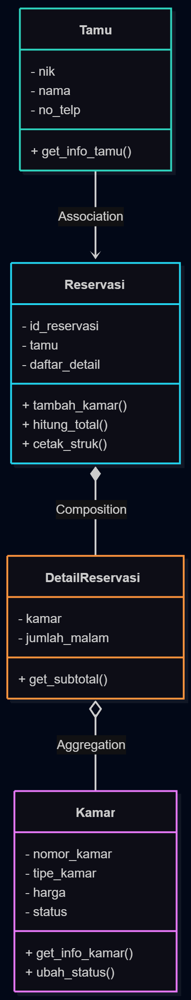
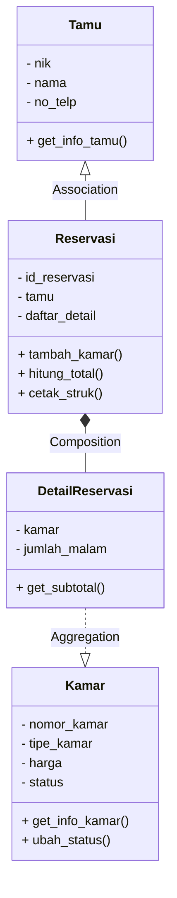

# Aplikasi Manajemen Reservasi Hotel — MVC + Streamlit + SQLite



Aplikasi berbasis **Object-Oriented Programming (OOP)**, arsitektur **MVC (Model-View-Controller)**, dan **Streamlit** untuk mengelola data kamar, tamu, dan reservasi hotel menggunakan **SQLite** sebagai database.

---

## Implementasi Sesuai Class Diagram



---

## Rincian Entitas

### 1. Tamu
- **Atribut**: nik (primary key), nama, no_telp
- **Method**: `get_info_tamu()` — mengembalikan informasi lengkap tamu
- **Relasi**: Ber-**Association** ke Reservasi (satu tamu dapat memiliki banyak reservasi)

### 2. Reservasi
- **Atribut**: id_reservasi (primary key), tamu (foreign key), daftar_detail (list detail reservasi)
- **Method**: 
  - `tambah_kamar()` — menambahkan detail kamar ke reservasi
  - `hitung_total()` — menghitung total harga reservasi
  - `cetak_struk()` — mencetak struk reservasi
- **Relasi**: Ber-**Composition** ke DetailReservasi (reservasi "memiliki" detail reservasi, jika dihapus reservasi, detailnya juga ikut hapus)

### 3. DetailReservasi
- **Atribut**: kamar (foreign key), jumlah_malam
- **Method**: `get_subtotal()` — menghitung subtotal berdasarkan harga kamar dan jumlah malam
- **Relasi**: Ber-**Aggregation** ke Kamar (detail reservasi "menggunakan" kamar, tetapi kamar dapat exist tanpa detail reservasi tertentu)

### 4. Kamar
- **Atribut**: nomor_kamar (primary key), tipe_kamar, harga, status (tersedia/tidak tersedia)
- **Method**: 
  - `get_info_kamar()` — mengembalikan info kamar beserta status
  - `ubah_status()` — mengubah status kamar (tersedia <-> dijual)
- **Relasi**: Menjadi target dari Aggregation oleh DetailReservasi

---

## Struktur Proyek MVC

```text
reservasi_hotel_mvc_database/
├── app.py
├── assets/
│   └── uml_reservasi.png
├── pages/
│   ├── 1_Kamar.py
│   ├── 2_Tamu.py
│   └── 3_Reservasi.py
├── models/
│   ├── __init__.py
│   ├── kamar.py
│   ├── tamu.py
│   ├── reservasi.py
│   ├── detail_reservasi.py
│   └── user.py
├── views/
│   ├── auth_view.py
│   ├── kamar_view.py
│   ├── tamu_view.py
│   └── reservasi_view.py
├── controllers/
│   ├── auth_controller.py
│   ├── kamar_controller.py
│   ├── tamu_controller.py
│   └── reservasi_controller.py
├── database/
│   ├── db.py
│   └── reservasi_hotel.db
├── tests/
│   ├── __init__.py
│   ├── test_kamar.py
│   ├── test_tamu.py
│   └── test_reservasi.py
├── requirements.txt
├── .env.example
└── README.md
```

---

## Akun Bawaan (Default Login)

- **Username**: `admin`
- **Password**: `admin123`

---

## Cara Menjalankan

1. **Clone atau pastikan berada di direktori proyek**

2. **Buat virtual environment** (disarankan):
```bash
python -m venv venv
.\venv\Scripts\activate
```

3. **Install dependencies**:
```bash
pip install -r requirements.txt
```

4. **Jalankan aplikasi**:
```bash
streamlit run app.py
```

5. **Buka browser** di `http://localhost:8501` dan login menggunakan kredensial di atas.